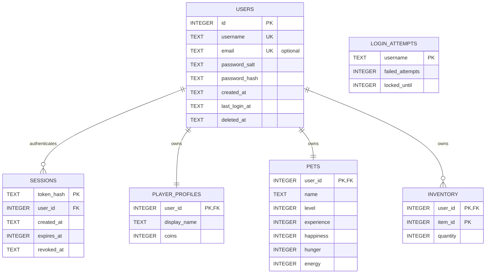

# User and game data model

Credentials are kept in `users`; mutable game state is kept in separate tables. Email is optional and reserved for account recovery. Passwords are never stored in plaintext: the application must validate the raw password, then store a password hash and its per-account salt using a dedicated password-hashing library.



## Validation and account lifecycle

- Username: 3–20 ASCII letters, digits, or underscores; uniqueness is case-insensitive.
- Password: at least 8 Unicode characters. This policy is validated before hashing; the database only receives the salt and hash.
- Email: optional; when supplied it must have a basic valid `local@domain.tld` shape and be unique without regard to case. A real recovery flow must verify ownership before sending reset links.
- `created_at` and `last_login_at` are UTC ISO-8601 timestamps. `last_login_at` stays empty until the first successful login.
- Change-password operations update only `users.password_salt` and `users.password_hash`; game tables are not touched.
- Account deletion is a soft deletion: mark `deleted_at`, clear username/email/salt/hash, and revoke sessions in one transaction. This preserves the game data and allows the login name/email to be reused. Foreign keys use `RESTRICT` for game data to prevent accidental hard deletion.
- The SQL schema in `backend/database/schema.sql` is canonical for new databases, and `backend/database/virtual_pet.template.db` has been migrated to the split model. Apply `backend/database/migrate_user_data.sql` once to older copies of the template. Migration assigns existing accounts a `user_<id>` username, preserves email/password hashes and game data, and invalidates existing sessions.

`User` in the C++ backend represents account credentials and metadata. `PlayerData`, declared in `backend/include/User/PlayerGameData.h`, represents game-facing identity, coins, and inventory, and is what the shop and reward modules modify.

## Registration endpoint

Build and run the local HTTP application from the repository root:

```powershell
cmake -S . -B build
cmake --build build --config Release
.\build\Pet_Raising_Server.exe
```

Open `http://127.0.0.1:8080/` and use **Tạo tài khoản**. The server serves the frontend and `POST /api/auth/register` from one origin, listens on loopback only, and stores accounts in `backend/database/virtual_pet.db` by default. To choose a port and database path, pass `[port] [database-path]` to the executable.

The registration endpoint accepts JSON `{ "username": "...", "email": "...", "password": "..." }`. Email is required and unique. Login accepts `{ "email": "...", "password": "..." }`. Passwords are hashed using Argon2id (3 iterations, 64 MiB, one lane, per-account cryptographic 16-byte salt); the raw password is never written to SQLite. The insert, initial 100-coin profile, default `UIA` pet, and empty inventory are created atomically. SQLite's case-insensitive UNIQUE constraints are the final guard against duplicate registrations.

## Login sessions

- `POST /api/auth/login` accepts the same JSON credentials. Incorrect usernames and passwords receive the same `401` response (`Sai tên đăng nhập hoặc mật khẩu`); unknown users still incur a dummy Argon2id hash.
- Five failed attempts for a username cause a five-minute lockout. Attempts are stored in SQLite and cleared after a successful login. A locked account receives the same public credential error.
- Successful login creates a cryptographically random, 256-bit session token. Only a derived hash is stored in `sessions`; the raw token is sent as an `HttpOnly`, `SameSite=Strict` cookie with a seven-day expiry.
- `GET /api/auth/session` restores the current account display from the cookie. `POST /api/auth/logout` revokes that session in SQLite and expires the cookie.
- The server binds only to `127.0.0.1`; deploy behind HTTPS and configure secure cookies before exposing it beyond the local development environment.

The frontend offers linked login and registration forms. Run the server and open its local URL (rather than loading the HTML via `file://`) so same-origin API requests and the session cookie work.

SQLite, Argon2, cpp-httplib, and nlohmann/json are fetched at configure time from pinned upstream versions and verified with SHA-256 hashes. An internet connection is needed for the first CMake configure; subsequent builds use the local CMake dependency cache.
